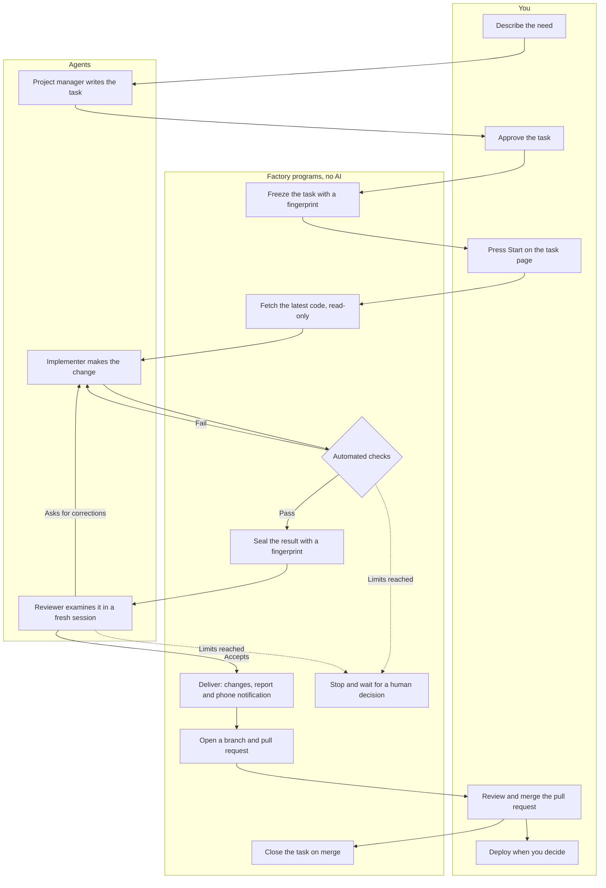
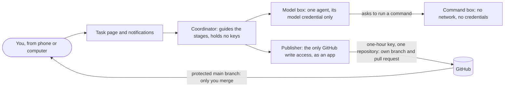

# Agent Factory — Case Study

**A small software development department staffed by AI agents, with a person as the lead.**

You describe what you need. A virtual project manager turns it into a precise task. One agent
builds it, a program checks it, a second agent reviews it, and the result comes back with its
evidence, ready to become a pull request. A person merges and deploys. Nothing is accepted because
an agent says it went well.

This repository explains how the factory works and how it evolves, in plain language. The long-term
goal is for a person to accept a change **by trying the product and examining the evidence, without
having to read its code**. That is a goal under development, not a guarantee of this version.

## A development department, in small

| In a team | In the factory |
|---|---|
| Product manager who clarifies the request | **Project manager agent**: talks with you and writes the task |
| Developer | **Implementer agent**: makes the change in an isolated workspace |
| Continuous integration | **Automated checks**: rules that apply without judgment |
| Code review | **Reviewer agent**: a different session that never sees the implementer's reasoning |
| Team lead or client | **You**: approve the task, merge the result and deploy |
| Issue tracker and history | **Record**: the state, evidence and cost of every task |

Each role can run on a different model, even from different providers, chosen per task. A model
never grants permissions: it only proposes.

## The life of a task

1. **Talk.** You explain the need to the project manager, from a phone or a computer. It reads the
   project and asks its questions at the start, not halfway through.
2. **Agree.** It proposes a task: goal, acceptance criteria, what is out of scope and which checks
   will apply. Your approval **freezes** that version with a fingerprint. Changing the scope later
   creates a new version; it never rewrites the agreed one.
3. **Start.** On the task's page you choose which model implements and which reviews, and press
   Start. The factory refuses to start on a project with an open pull request, then fetches the
   latest code with a read-only key.
4. **Build.** The implementer works in an isolated workspace. Its commands run in a second box with
   no network and no credentials, and every command is recorded.
5. **Check.** Programs apply the task's rules: only allowed files changed, no secrets, instruction
   files untouched unless you approved that exact change. A failure goes straight back to the same
   implementer session.
6. **Review.** The result is sealed with a fingerprint, so the reviewer examines exactly that.
   Corrections go back to the implementer. After three implementer sessions or three reviews, the
   task stops and waits for you.
7. **Deliver.** The changes and a report — cost, tokens, rounds and minor findings — appear on the
   task's page, and your phone gets a notification.
8. **Merge.** The factory pushes its own branch, opens the pull request assigning you as
   reviewer, and closes the task when you merge. It publishes as a **dedicated GitHub App**: an
   identity for programs, installed only on the chosen repositories, that may write code and pull
   requests and nothing else. Each publication gets a one-hour key valid for a single repository.
   GitHub's own rules keep the protected branches for you alone. Tested against GitHub with the
   app: writing to protected branches, creating tags, changing workflows, merging its own pull
   request (also into the production branch), starting a workflow, reading secrets, changing
   settings or rules and granting access were all rejected; its own branch and pull request were
   accepted.
9. **Deploy.** Only a person deploys, from GitHub or by asking an assistant that uses their own
   account. The factory never deploys.

Every step leaves a record: which version of the code and the task was used, what changed, what was
checked, who decided and what it cost. The record is chained, so altering an entry is detectable.

To judge a deliverable you need the exact task it was built against. Each task's page shows the
**complete approved task**, folded away until opened, only if it matches the fingerprint recorded at
approval; otherwise it says it is not available instead of showing a different text.

## Who can do what

The design assumes that an agent can be manipulated by what it reads, and that the machine it runs
on could be lost entirely. So each piece holds only what its job needs.

| Piece | Can | Cannot |
|---|---|---|
| Agents | Read the task material and propose changes | See other agents' work, reach the home network, hold keys, publish |
| Command box | Run the agent's commands | Reach the network or any credential |
| Coordinator | Guide the stages and record everything | Use any key |
| Publisher | Push a new branch and open its pull request | Merge, deploy, start or change workflows, touch secrets or change settings |
| GitHub rules | Reject writes to protected branches | — they hold even if the factory were compromised |

**Why an app and not a second user account.** A collaborator account with write access can, on
GitHub, start any workflow by hand — including the ones that deploy to production — and replace the
secrets those workflows use. Branch rules do not cover either. An app only gets the permissions it
is given, so those actions are refused by GitHub itself, not by the factory's own code.

Two lessons from the switch:

- **A required approval is not necessarily a human one.** An app's approval may count. To keep the
  production branch for the person, the rule that works is "only the owner may update it".
- **Credentials change shape.** In 2026 the one-hour keys GitHub hands to apps (installation
  tokens) grew from about 40 to about 520 characters, with dots and dashes. The publisher's format
  check predated that and rejected the first real one. Checking against the real GitHub before
  switching over caught it; the tests now use a key of the new shape.

## Where it stands

| Part | Status |
|---|---|
| Conversation, frozen task, implementer, automated checks, independent review, record | **Verified** on real tasks, so far documentation and analysis work |
| Task page, start from the phone, model choice per role, notifications | **Verified** |
| [Terminal for the agents](agent-terminal.md), with no network | **Verified**: the same task took 12 minutes instead of 29 |
| Automatic branch and pull request, task closed on merge | **Installed**, publishing as a dedicated GitHub App; GitHub's rejection of forbidden operations, including deploys and secrets, **verified**; the first pull request from a real task is pending |
| [Installing a project's dependencies](dependencies.md), so code tasks can run their tests | **Verified on the factory's machine** for one app, wired into the agents' boxes and a verifier with no model; no real task yet |
| Code tests and checks on the running product | **Planned** |

## How a deliverable will be assessed

| Layer | What it checks | Today |
|---|---|---|
| Automated rules | Whether the change meets the task's mechanically verifiable conditions | In the workflow |
| Code tests | Whether the program's parts behave as expected | To be added |
| Running product | Whether the website or app works for the expected user journeys | To be added |
| Independent review | Whether the result meets the task, and what else is wrong | In the workflow |
| Human testing | Whether it solves the actual need | Always human; the testing experience is to be built |

Passing one layer does not replace the others.

The [quality roadmap](quality-roadmap.md) explains the planned steps toward a dependable starting
point: checkable tasks, review that converges, tests of the product and the reviewer, and recovery
before unattended work. It describes design goals, not completed capabilities.

## A case study that grows with the project

Each update answers three questions: **What was the problem? What changed, and how does it work
now? What evidence is there, and what remains open?** Deep dives so far:

- [A terminal for the agents](agent-terminal.md): how agents run commands without network or
  credentials, and what it saved.
- [Dependencies without network](dependencies.md): how a project's packages get installed without
  showing the code to the Internet or letting a task change them. Work in progress.
- [Checking the checks](checking-the-checks.md): planted translation mistakes exposed gaps in
  existing checks. Local measurements, not a completed translation gate.

Maintenance instructions are in [AGENTS.md](AGENTS.md).
