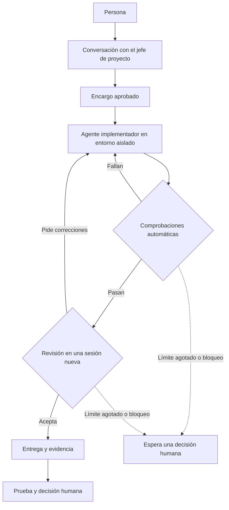

# Agent Factory — caso de estudio

**Una factoría personal de agentes: de una conversación a una entrega comprobable.**

Este repositorio explica, para personas, cómo se diseña y evoluciona una factoría de
trabajo con IA. Empieza con una vista sencilla y crecerá con los avances del proyecto:
diagramas, ejemplos y decisiones explicadas con sus resultados.

El objetivo final es que una persona pueda aceptar un cambio **probando el producto
y consultando las evidencias, sin tener que leer su código**. Es un objetivo en
construcción, no una garantía de esta primera versión.

## Cómo funciona

1. **Conversar.** Un jefe de proyecto virtual aclara la petición con la persona.
2. **Acordar.** Se fija un encargo: objetivo, límites y criterios de aceptación.
3. **Trabajar.** Un agente recibe una versión concreta del proyecto en un entorno aislado.
4. **Comprobar.** Un programa verifica reglas concretas sobre la entrega.
5. **Revisar.** Otro agente examina el resultado en una sesión nueva. Si encuentra
   problemas, el trabajo vuelve para corregirse; si se agotan los límites, espera
   una decisión humana.
6. **Entregar.** La persona recibe los cambios y la evidencia, y decide si los acepta.

El recorrido deja un registro: qué versión se usó, qué cambió, qué se comprobó y
qué decisión se tomó. El resultado revisado se identifica con una huella de su
contenido, para que la revisión corresponda a esa entrega exacta.

## Las piezas, en llano

| Pieza | Responsabilidad |
|---|---|
| **Jefe de proyecto** | Convertir una necesidad en un encargo claro. |
| **Coordinador** | Preparar el material y conducir las etapas; es un programa, no otro agente que improvisa el flujo. |
| **Implementador** | Producir los cambios del encargo. |
| **Comprobaciones automáticas** | Aplicar reglas sin opinión: archivos permitidos, formato o detección de secretos, según la tarea. |
| **Revisor** | Examinar el resultado sin heredar el razonamiento del implementador. |
| **Registro** | Conservar decisiones y evidencias del recorrido. |
| **Persona** | Definir el objetivo y dar la aceptación final. |

## Herramientas y separación

La separación es una parte central del diseño: el agente trabaja sobre el material
de su tarea; las operaciones con permisos se controlan desde fuera de su entorno.
Una propuesta del modelo no concede permisos por sí misma.

Una de las siguientes piezas es **dar terminal y herramientas a los agentes** para
que puedan ejecutar comprobaciones útiles, manteniendo separado el entorno de
ejecución de las credenciales del modelo. Este caso de estudio explicará esa
frontera y sus resultados cuando la solución esté verificada.

## Cómo sabremos que una entrega está bien

El objetivo combina cinco capas:

| Capa | Qué comprueba | Situación de partida |
|---|---|---|
| Reglas automáticas | Que el cambio respete las condiciones comprobables del encargo. | Parte del recorrido básico. |
| Tests del código | Que las piezas del programa se comporten como se espera. | Por incorporar al flujo de producción de código. |
| Producto funcionando | Que la web o la aplicación se pueda usar y cumpla los recorridos esperados. | Por incorporar. |
| Revisión independiente | Que el resultado responda al encargo y detectar problemas adicionales. | Parte del recorrido básico. |
| Prueba de la persona | Que el resultado resuelva la necesidad real. | La aceptación sigue siendo humana; la experiencia de prueba del producto está por construir. |

Pasar una capa no sustituye a las demás. Cada avance debe explicar qué se ha
comprobado realmente y qué sigue siendo un objetivo.

## Un caso de estudio que crece con el proyecto

La primera versión se limita al recorrido y a las responsabilidades. Conforme
avance la factoría, añadiremos ejemplos de encargos, diagramas de sus fronteras,
resultados medidos y lecciones aprendidas.

Cada mejora responderá a tres preguntas:

- **¿Qué problema había?**
- **¿Qué cambió y cómo funciona ahora?**
- **¿Qué evidencia tenemos y qué queda por resolver?**

La documentación está pensada para entender el sistema sin conocer su código ni
su infraestructura privada. Las instrucciones de mantenimiento están en
[AGENTS.md](AGENTS.md).
