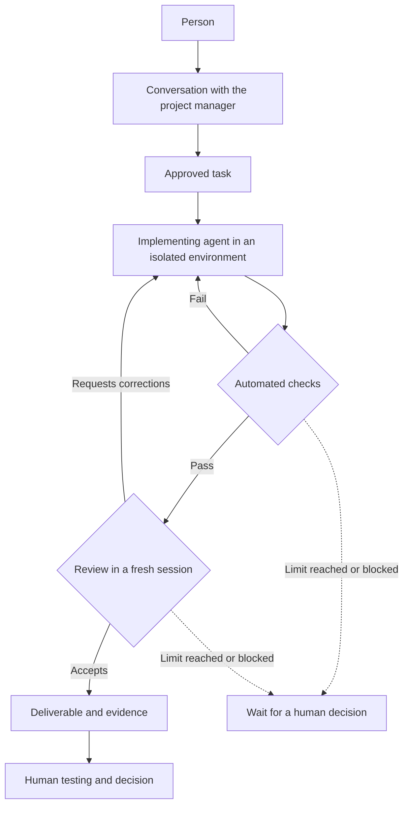

# Agent Factory — Case Study

**A personal agent factory: from a conversation to a verifiable deliverable.**

This repository explains how a personal AI agent factory is designed and evolves,
in plain language. It starts with a simple overview and will grow alongside the
project, with diagrams, examples, and decisions explained through their outcomes.

The long-term goal is for a person to accept a change **by trying the product and
examining the evidence, without having to read its code**. This is a goal under
development, not a guarantee provided by this first version.

## How it works

1. **Discuss.** A virtual project manager clarifies the request with the person.
2. **Agree.** A task is defined and fixed: its goal, boundaries, and acceptance criteria.
3. **Work.** An agent receives a specific version of the project in an isolated environment.
4. **Check.** A program verifies concrete rules against the deliverable.
5. **Review.** Another agent examines the result in a fresh session. Problems send
   the work back for correction; if the limits are reached, the task waits for a
   human decision.
6. **Deliver.** The person receives the changes and evidence, and decides whether to accept them.

The workflow leaves a record: which version was used, what changed, what was
checked, and which decision was made. A content fingerprint identifies the
reviewed result, tying the review to that exact deliverable.

## The components, in plain language

| Component | Responsibility |
|---|---|
| **Project manager** | Turn a need into a clear task. |
| **Coordinator** | Prepare the material and guide the stages; it is a program, not another agent improvising the workflow. |
| **Implementer** | Produce the changes required by the task. |
| **Automated checks** | Apply rules without judgment: allowed files, formatting, or secret detection, depending on the task. |
| **Reviewer** | Examine the result without inheriting the implementer's reasoning. |
| **Record** | Preserve decisions and evidence from the workflow. |
| **Person** | Define the goal and give final acceptance. |

## Tools and separation

Separation is central to the design: the agent works on its task material, while
privileged operations are controlled from outside its environment. A model's
proposal does not grant permissions by itself.

One of the next steps is **giving agents a terminal and tools** so they can run
useful checks, while keeping the execution environment separate from model
credentials. This case study will explain that boundary and its outcomes once
the solution has been verified.

## How we will assess a deliverable

The goal combines five layers:

| Layer | What it checks | Starting point |
|---|---|---|
| Automated rules | Whether the change meets the task's mechanically verifiable conditions. | Part of the basic workflow. |
| Code tests | Whether the program's components behave as expected. | To be incorporated into the code-production workflow. |
| Running product | Whether the website or application is usable and supports the expected user journeys. | To be incorporated. |
| Independent review | Whether the result meets the task requirements, and whether there are additional problems. | Part of the basic workflow. |
| Human testing | Whether the result solves the actual need. | Acceptance remains human; the product-testing experience has yet to be built. |

Passing one layer does not replace the others. Each update should explain what
has actually been verified and what remains a goal.

## A case study that grows with the project

The first version focuses on the workflow and responsibilities. As the factory
progresses, we will add task examples, boundary diagrams, measured results, and
lessons learned.

Each update will answer three questions:

- **What was the problem?**
- **What changed, and how does it work now?**
- **What evidence do we have, and what remains unresolved?**

This documentation is intended to make the system understandable without knowing
its code or private infrastructure. Maintenance instructions are in
[AGENTS.md](AGENTS.md).
