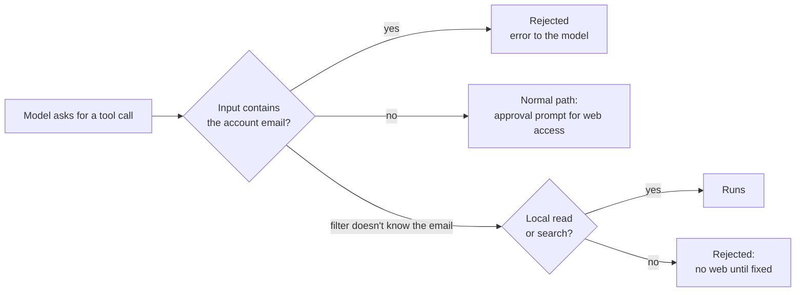

# Keeping the account email out of web requests

## The problem

The factory has a conversational agent per workstream, the **product owner**: the agent you talk to
in order to turn an idea into a task. It is the only role allowed to read web pages and search the
web, and each request needs a person to approve it.

When that agent runs on a Claude model, the program that runs Claude places the email of the logged-in
account into the model's context. Asked to, the model will put that address into a web request. It
was reported publicly that the program sometimes sent it in a request header on its own. Measured
here: the agent has no shell, so the header vector does not exist, but a URL or a search query can
still carry the address. The only barrier was a person reading the URL before clicking *approve*.

The email is not a grave secret, and the provider is working on it. The goal was a **small,
deterministic barrier**, not a defence against a model that tries hard to hide it.

## How it works now

A small plugin of the agent server looks at **every tool call before it runs and before any approval
prompt**. If the call's input contains the account's email, the call is rejected: nothing runs, the
person sees no prompt, and the model gets an error explaining why, without repeating the address.

- **What is compared:** the full address, ignoring case, anywhere in the call's input (URL, search
  text, any field), as written and with URL encoding undone.
- **Which tools:** all of them, not a list. A new tool is covered without changing anything.
- **Where the address comes from:** the agent's own Claude login, asked from the Claude program when
  the server starts. It is never written to the repository, a config file or a log.
- **Where it acts:** only in a process that has been given a Claude, the product owners. Coding
  agents are left alone: the owner's email can legitimately appear in project files, and blocking an
  agent that edits them would protect nothing.
- **When it cannot learn the email** (for example, after an update changes the output it reads): the
  agent keeps talking and reading the code, but loses web access and says so. Letting calls through
  would be a silent failure; this one is noticed on first use.

Out of scope on purpose: split or encoded variants of the address, other account data, and text the
agent writes into a task, which the person reads before approving it.

## Evidence

- **Tests without a model:** the address in a URL, a search, a nested field, upper case, encoded once,
  twice and three times; a similar but different address passes; the three states; neither the error
  nor the log contain the address. Hand mutations (no decoding, no case folding, letting calls
  through when the email is unknown, and eight more) were each caught by a test.
- **Seeded attempt against the real agent**, after installing and after every update. A control call
  without the email must reach the approval prompt; then the model is asked to put its account email
  in a URL to a domain that does not exist, and that call must be blocked with no prompt. It uses the
  real email via the model, not a fixed marker: a marker only proves the hook runs, the real value
  also proves the filter learned the email.
- **Rehearsed on a workstation:** pass with the filter, fail without it, and fail in the control when
  the account answer changes shape. One twist: the first "filter removed" run still passed, because
  the agent server also loaded a config file it found by walking up from the project folder, and that
  copy still listed the filter. Renamed, the run failed as it should. A negative control that passes
  is a finding about the test before it is good news.
- **Verified on the factory's machine** (November 2026), with both product owners: the attempt was
  blocked with no prompt in each, the control reached the prompt, and the log showed "no account"
  before each login and "has the email" after it.

## What remains open

- The check follows the runtimes, which update almost daily: it is repeated after each update, not
  assumed.
- Text written by the agent into tasks or chat is not filtered; a person reads it before approving.
