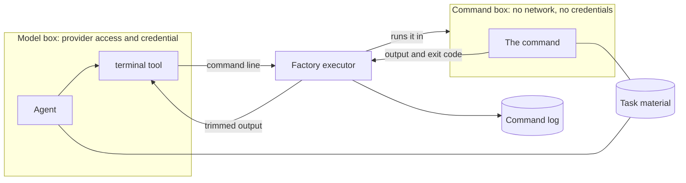
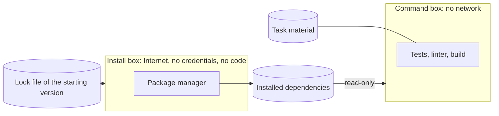

# A terminal for the agents

**Status: verified** for the first part, a terminal with no network and no new
tools. Installing a project's dependencies is a second part: **designed, not
built yet** ([below](#next-dependencies-designed-not-built-yet)). The savings compared with working without a terminal have been
measured in **a single repetition** of the same task.

## What was the problem?

The factory's agents could read, search and, in the implementer's case, edit
files. They could not run anything. The reason was sound: a free-form command runs
with the permissions of whatever launches it, and the program that talks to the
model has Internet access and the credential for the model provider.

The cost showed up in a documentation task with countable acceptance criteria. One
of them asked for a word count. Unable to run a word-count command, the
implementer counted by searching: **301 searches, 27 minutes, and about 10.59 USD
of equivalent usage** on its own, for a task that changed a handful of text
files. The result was correct. The route was not: an agent that cannot check
something with a command checks it by rereading, and rereading is the most
expensive thing it does.

The same would apply, more severely, to code. Without a terminal there are no
tests, no linting and no build.

## What changed, and how does it work now?

The program that talks to the model still has no terminal. Instead there is **a
second box**, and commands run there.

| Component | In plain language |
|---|---|
| **Model box** | Where the agent runs. It can reach its model provider and holds the credential to do so. It does not run commands. |
| **Command box** | A separate box with no network and no credentials. It sees only the task material. It opens and closes with each command. |
| **`terminal` tool** | The only new thing the agent sees. It runs nothing: it hands the command line to the component that does. |
| **Executor** | A factory program outside both boxes, alive for as long as the agent's turn lasts. It receives each line, runs it in the command box and writes it down. |
| **Command log** | Where the executor records every command. Neither the agent nor its commands can reach it. |

The agent asks for `wc -w report.md`. The tool passes that line to the executor.
The executor opens the command box, runs the line, records what happened and
returns the output. The command never runs where the credential and the Internet
are, and the part that has Internet never runs a command.

### Who can do what

| Role | Terminal | On its task material |
|---|---|---|
| Implementer | Yes | Reads and writes: a command can create or change task files. |
| Reviewer | Yes | Reads only. It has a scratch folder for its own checks, outside what it reviews. |
| Project manager | No | — |

The reviewer was already forbidden from changing what it reviews, and a rule
rejected the review if it did. With its copy mounted read-only, it can no longer
happen.

If the terminal is not installed, an implementer or reviewer turn does not start.
There is no fallback that runs commands somewhere else.

### What gets recorded

For each command: the exact line, the exit code, the duration, whether it was cut
off for time, the size and fingerprint of its output, and the output itself,
trimmed when very long. Rejected requests are recorded too. The log joins the rest
of the task's evidence, and the delivery report gains a section listing the
commands of each round.

The log is kept by the executor, not by the agent, for a measured reason: in one
test, a model reported having run a command that the log did not contain. **What
an agent says it ran is not what ran.**

### Limits

| Limit | Value |
|---|---|
| Commands at once | One |
| Time per command | One hour by default and at most; the agent can request less |
| Time per implementer or reviewer execution | Six hours |
| Time without output from the agent | 90 minutes |
| What returns to the agent from long output | The beginning and the end, with the total size |
| Processes inside the box | 512 |

The time limits were increased so a compilation does not depend on the agent remembering
to request a longer timeout. A command returns as soon as it finishes: one hour is a ceiling,
not a minimum. The agent programs wait slightly longer than the command limit to receive
its result. Execution and silence limits keep waiting bounded; they are not a task spending
cap. A long call with the real agent programs remains to be measured with coding tasks;
the real command measured in the first implementation lasted 70 seconds.

## What evidence do we have?

These were checked on the factory's own machine, with the real agent programs and
the configuration that only the administrator can change. The last row is a
property of the test suite.

| Claim | How it was checked |
|---|---|
| The command box cannot reach the Internet | A connection from inside fails; from outside, the same machine connects. |
| It sees no credentials and none of the agent's state | The locations where they live do not exist inside the box. |
| The reviewer cannot write to what it reviews | The attempt fails with a read-only filesystem error. |
| A flood of processes is stopped | It hits the cap: no more processes can be created. |
| Both agent programs get the terminal and nothing else to run commands with | Two different agent programs, each as reviewer and as implementer: they offer the `terminal` tool and not their built-in command tool. |
| A command longer than a minute returns in full | A 70-second command, in both programs. |
| Every requested command is in the log | Comparing what was requested with what was recorded. |
| The tests notice when a piece is undone | 31 deliberate changes that each break the design; all 31 were detected. |

These are checks of specific behaviours, not a general guarantee that the box
cannot be escaped.

### The same task, repeated

The 301-search task was run again with the terminal: the same request, the same
starting material and the same model in both roles. Both times the reviewer
accepted the result on the first review.

| | Without a terminal | With the terminal |
|---|---|---|
| Duration, implementer and reviewer | 29 min | **12 min** |
| Implementer tool calls | 341, of which 301 were searches | **60**, of which 46 were commands |
| Implementer peak context | 376,777 tokens | **185,856** |
| Equivalent API cost | 11.72 USD | **4.61 USD** |

The 58 commands of both roles added up to 3.2 seconds of execution: the time and
the cost are in the model, not in the commands. The review changed too. This time
the reviewer **recomputed**: it took the counting procedure out of the report, ran
it on the original material and compared. Without a terminal there was no sign it
had recomputed anything.

This is one repetition, with a model that does not answer the same way twice. It
shows the direction and the order of magnitude, not a figure that will repeat.

## What remains unresolved?

- **Commands run under the same system identity as the agent**, on the same
  material. This is the simple option. Its risk: a flaw that let a command escape
  its box would reach the provider credential. That risk is accepted while the
  machine is a disposable virtual machine dedicated to this work. Destroying the
  machine does not undo a credential that has already been stolen.
- **No memory or CPU limit.** One command can exhaust the machine. Restarting it
  fixes that and nothing in the record is lost. A memory cap per turn is part of
  the second part's design, not built yet.
- **No network and no installing.** Only what the machine already has is
  available. Running a project's tests and linter needs its dependencies. That is
  the second part, below.
- **A task cannot add or update dependencies**, for now.
- **One repetition is not a distribution.** How much the savings vary between runs
  is unknown, and so is how much memory and CPU a round uses when it runs tests or
  a build: the measured task only handled documentation.

## Three lessons

- **A time limit nobody asked for.** One of the agent programs cuts off a call to
  an external tool after 60 seconds. The agent received an error while the command
  kept running. The fix is a configuration setting whose documentation describes
  something else; it was found by timing a 70-second command, not by reading.
- **The shell matters.** The terminal ran commands with the system's minimal
  shell, and both agents once wrote `bash` syntax even though the tool's
  description named the shell: an error, and a wasted turn each. It was switched to
  `bash` the same day. Giving agents the shell they already write is cheaper than
  explaining a different one.
- **Measure a control with the real program and its real configuration.** A
  laptop does not have the administrator-only policy, so what was measured there
  was not enough. The verification that counts was done on the factory's machine.

## Next: dependencies (designed, not built yet)

**Status: designed and decided, not built.** Nothing in this section has been
measured on the factory's machine yet.

**The problem.** A web project's tests, linter and build need its dependencies:
hundreds of third-party packages. The command box has no network, so they must be
installed beforehand. And installing means running someone else's code: some
packages run a program of their own when installed.

**How it will work:**

1. The person decides the dependencies, outside the factory. The project's lock
   file pins every version with its fingerprint.
2. Before the first turn, **the factory installs, not the agent**: exactly what
   the lock file says in the starting version. It does so in a third box that has
   Internet access but no credentials, and that **sees only the dependency lists**,
   not the project's code.
3. What gets installed is mounted **read-only** in the command box of the
   implementer and of the reviewer.
4. A rule **rejects any deliverable that changes dependencies**. If the agent
   needs a new library, it stops and says so.

| Decision | Why |
|---|---|
| Dependencies live outside the task material, read-only | A stuck agent cannot "fix" a test by patching a library where nobody looks. The deliverable does not carry them, and the reviewer tests against the same installation. |
| No cache between tasks, with a time watcher | One task cannot contaminate the next. Each installation records how long it took and what it downloaded; if it exceeds 5 minutes or 20% of the task, the report flags it, and that data decides whether a cache is worth it. |
| A deliverable that changes dependencies is rejected | What was tested is what gets delivered, and the person chooses the third-party code. |
| A memory cap per turn | One command can no longer exhaust the machine. |
| Exact runtime and package-manager versions, from their official source, checked by fingerprint | Without network the package manager cannot download itself; if a task asks for a version that is not installed, it does not start. |

**The accepted risk.** The install programs of the allowed packages run with
Internet access. They see no credentials and no code. The worst they can leave
behind is a malicious binary, which would then run with no network and no
credentials. The lock file's fingerprints and a one-day wait before accepting a
freshly published version narrow that risk.

**What preparing it taught.** Two findings came from measuring, not from reasoning:

- **A deliverable is compared file by file with the original.** Dependencies
  installed inside the task material, hundreds of megabytes and tens of thousands
  of files, would have ended up in it. That is why they live outside.
- **An audit of each project, before touching the factory,** found what broke
  working offline: a font downloaded at build time, the package manager trying to
  download its own version, and an in-house package on a registry that required a
  credential even to download. Those are fixed in each project, not in the factory.
