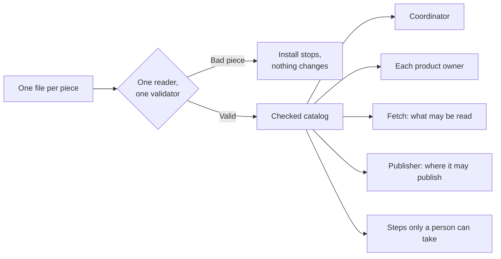

# Connecting a repository is declaring it, not programming it

The factory keeps a catalog of what it is connected to: which workstreams exist, which repositories
each one may read, which shared guides each repository receives and which extra checks it runs.
The goal is for anyone to add those pieces the way you add a plugin to a product. This page covers
the first step: turning that catalog into one file per piece.

## The problem

- **One big file with copied blocks.** The whole catalog lived in a single file. The block saying
  which guides a repository receives was copied, almost identical, into three repositories.
- **Many readers, each with its own rules.** About ten programs read that file, each in its own way.
- **Closed lists elsewhere.** What the factory may fetch, and where it may publish, were two more
  lists written by hand inside two programs. Connecting a repository meant editing three places.

## How it works now

**A piece is a small file that describes one connected thing.** Connecting is adding a file;
disconnecting is deleting it.

```text
pieces/
  workstreams/development/workstream.json   a workstream: its agent's port and the repositories it uses
  workstreams/marketing/workstream.json
  library/repositories/knowledge.json       where to read it, whether to publish, its guides and checks
  library/repositories/web-app.json
  library/guides/product.json               a set of guides, with a slot for each repository's own
  library/checks/translations-sorted.json   a check a repository can switch on
```

- **Shared pieces live in a library.** A workstream names the repositories it uses, so one
  repository can serve several workstreams. A product's knowledge repository, for example, can serve
  development, marketing and finance.
- **No copied blocks.** A repository says "I receive the *product* guide set", plus the guides for
  its own technology, which the set places in a slot of its own.
- **One reader and one validator.** Every program, including the command on the person's computer,
  reads the catalog through the same small library, which hands over the catalog already checked.
- **What is connected is what is allowed.** What the factory may fetch, and where it may publish,
  now come from the pieces. A piece grants no credentials, though. A person still creates the
  read-only key for a private repository, installs the publishing app and reviews a repository
  before its first pull request. The validator lists those steps.
- **Checked before installing.** The install command runs the candidate's own validator first,
  with the command's own privileges: it is the same code that is about to be installed, so it adds
  no new risk, but it means the check step is not purely a read. A
  piece with an unknown field, a name that does not exist or a repository no workstream uses stops
  the install before anything changes.
- **No extra line in the install map.** The [install map](installing-changes.md) carries the whole
  pieces folder, so a new piece travels on its own.



## What was verified

| Check | Result |
|---|---|
| Same behavior | The new reader returns the old catalog field by field and in the same order. Each repository's guide profile has the same fingerprint, so no recorded task notices the change |
| Connecting | In tests, a new repository connects with its piece and one line in its workstream, and another serves two workstreams. Every kind of bad piece tried was rejected |
| On the factory's machine | Installed by the owner with approval. Health check green: the catalog valid, both conversational agents answering, the email filter blocking on both, the task record intact and 36 test suites passing |

## Lessons

- **The first version took a capability away.** It allowed a repository in only one workstream,
  which the old file allowed. It was corrected the same day: a step meant not to change behavior
  must not lose anything.
- **Removing one thing exposes another.** Repositories nested inside others (submodules) had not
  been used for a long time and were removed. That left an early check profile, written for a
  report about one of them, impossible to satisfy. It was retired. The part needed to re-verify what
  that old task recorded was kept, because the health check still verifies it.
- **Some failures only show up on the real machine.** Two test bugs appeared only there, where the
  test copy is read-only. One test tried to edit copied files; another left Python caches behind.
  Both are now rehearsed the same way on the computer before installing.

## Limits

- There were four kinds of piece: workstream, repository, guide set and check. Technologies became
  the fifth in the next step ([three levels](technology-checks.md)). Pieces for tools that connect
  to the real world for testing, or for workstreams that are not about software, are still to be
  designed.
- A new workstream still needs its own agent service, key and web route set up by hand.
- A piece only takes effect from the reviewed main branch, installed by a person. There is no
  screen for adding pieces yet.
