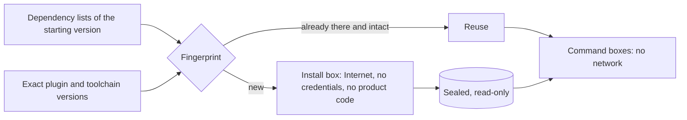

# Dependencies without network for the agents

**Status: design decided, first version built, not yet run on the factory's
machine.** The lessons below were measured in a local rehearsal with the network
cut off. None of this is verified on the factory yet.

## What is the problem?

The agents' [terminal](agent-terminal.md) has no network and no credentials.
That is what makes it safe to let an agent run commands. But a mobile app's
tests, linter and build need its dependencies: hundreds of third-party packages,
a custom linting plugin and, for the tests, a native database library. Without
network, nothing can download them.

Installing them means running other people's code with Internet access, so the
installation itself has to be contained too.

## How will it work?

Installing is split from working, and each step gets the least it needs.

| Step | Network | What it sees |
|---|---|---|
| **Install box**, run by the factory, never by the agent | Internet, no credentials | Only the dependency lists of the starting version, plus a sample project made up for the purpose. **Not the product's code.** |
| **Sealing** | None | The result becomes owned by an administrator account and read-only. A fingerprint of every file goes into a manifest. |
| **Command boxes** of the implementer and the reviewer | None | The task's code and the sealed dependencies, read-only. |

### Install once per fingerprint

The first design reinstalled for every task and deleted afterwards, so that one
task could not leave anything behind for the next. Building it showed a simpler
way to get the same guarantee:

- The installation lives in a folder **named after the fingerprint** of what
  determines it: the lock file and dependency settings of the starting version,
  the exact version of the linting plugin, and the toolchain version.
- If the next task computes the same fingerprint, it **reuses** the folder. If
  anything changed, it installs a new one automatically.
- No agent can write to it. Before reusing it, the factory compares every file
  with the manifest.

What this means day to day:

| What changes in the product | What the factory does |
|---|---|
| Code, tests, texts, with the same dependencies | Reuses the installation; nothing to download |
| A dependency is added or upgraded | New fingerprint: installs before the task, with no human step |
| The linting plugin gets a new version | The same: new fingerprint, automatic install |
| A deliverable that changes dependencies | Rejected: the person chooses third-party code, outside the factory |

Reinstalling the same lock file for every task would not protect against a
malicious package either: that file already pins it, so it would come back each
time.

## What measuring taught before building

These came from a local rehearsal with the network blocked, not from reasoning:

- **"Downloaded beforehand" is not "works offline".** The analyzer starts its
  linting plugin by resolving the plugin's dependencies again, on the Internet,
  even when they are already downloaded. Offline, the plugin did not load. The
  fix uses a standard feature of the package manager: a file that points those
  dependencies at the local copy. It goes into the analyzer's own helper package,
  **never into the product**.
- **A green result can be false.** One of the analysis commands reported success
  on code with a violation planted on purpose, because the plugin had not loaded.
  So every check plants a known violation and requires **that specific
  finding**, not just an exit code.
- **Blocking DNS is not blocking the network.** The first isolation profile
  blocked names but still let traffic out by IP address. The check is now
  two-sided: the same address with network and without it.
- **Tests downloaded things too.** A database library fetches its native binary
  the first time it is used. The factory downloads it in the networked step,
  checks it against the fingerprint the package itself publishes, and places it
  where the library looks, without faking the library's own installer.

## What is still open

- Running the install and the measurement on the factory's machine. Until then,
  everything above is design plus a local rehearsal.
- Wiring the sealed dependencies into the agents' command boxes and into the
  automated checks.
- Old fingerprints take disk space until someone retires them. Retiring one is a
  human decision: the factory moves it aside and never deletes it on its own.
