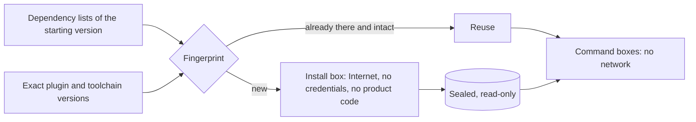

# Dependencies without network for the agents

**Status: verified on the factory's machine** for one mobile app: installed by
hand, wired into the agents' command boxes and checked by a verifier with no
model. Not yet used by a real task with models.

## What is the problem?

The agents' [terminal](agent-terminal.md) has no network and no credentials.
That is what makes it safe to let an agent run commands. But a mobile app's
tests, linter and build need its dependencies: hundreds of third-party packages,
a custom linting plugin and, for the tests, a native database library. Without
network, nothing can download them.

Installing them means running other people's code with Internet access, so the
installation itself has to be contained too.

## How does it work?

Installing is split from working, and each step gets the least it needs.

| Step | Network | What it sees |
|---|---|---|
| **Install box**, run by the factory, never by the agent | Internet, no credentials | Only the dependency lists of the starting version, plus a sample project made up for the purpose. **Not the product's code.** |
| **Sealing** | None | The result becomes owned by an administrator account and read-only. A fingerprint of every file goes into a manifest. |
| **Command boxes** of the implementer and the reviewer | None | The task's code and the sealed dependencies, read-only. |

### Install once per fingerprint

The first design reinstalled for every task and deleted afterwards, so that one
task could not leave anything behind for the next. Building it showed a simpler
way to get the same guarantee:

- The installation lives in a folder **named after the fingerprint** of what
  determines it: the lock file and dependency settings of the starting version,
  the exact version of the linting plugin, and the toolchain version.
- If the next task computes the same fingerprint, it **reuses** the folder. If
  anything changed, it installs a new one automatically.
- No agent can write to it. Before reusing it, the factory compares every file
  with the manifest.

What this means day to day:

| What changes in the product | What the factory does |
|---|---|
| Code, tests, texts, with the same dependencies | Reuses the installation; nothing to download |
| A dependency is added or upgraded | New fingerprint: installs before the task, with no human step |
| The linting plugin gets a new version | The same: new fingerprint, automatic install |
| A deliverable that changes dependencies | Rejected: the person chooses third-party code, outside the factory |

Reinstalling the same lock file for every task would not protect against a
malicious package either: that file already pins it, so it would come back each
time.

## What measuring taught before building

These came from a local rehearsal with the network blocked, and were later
confirmed on the factory's machine:

- **"Downloaded beforehand" is not "works offline".** The analyzer starts its
  linting plugin by resolving the plugin's dependencies again, on the Internet,
  even when they are already downloaded. Offline, the plugin did not load. The
  fix uses a standard feature of the package manager: a file that points those
  dependencies at the local copy. It goes into the analyzer's own helper package,
  **never into the product**.
- **A green result can be false.** One of the analysis commands reported success
  on code with a violation planted on purpose, because the plugin had not loaded.
  So every check plants a known violation and requires **that specific
  finding**, not just an exit code.
- **Blocking DNS is not blocking the network.** The first isolation profile
  blocked names but still let traffic out by IP address. The check is now
  two-sided: the same address with network and without it.
- **Tests downloaded things too.** A database library fetches its native binary
  the first time it is used. The factory downloads it in the networked step,
  checks it against the fingerprint the package itself publishes, and places it
  where the library looks, without faking the library's own installer.

## What the factory's machine taught

It took four rounds on the factory's machine. In the end, with no network and on
the latest version of the app's main branch:

| Check | Result |
|---|---|
| Planted lint violation | Found, with the exact finding |
| Analysis of the real code | Clean |
| Tests | 637 passed |
| Web build | Finished |
| Sealed installation after the checks | Unchanged, file by file |
| Product files changed by the checks | None |

The sealed installation takes about 490 MB.

- **The toolchain writes into itself.** The first time it runs, the app's build
  tool prepares its own parts inside its install folder. Read-only, it failed.
  Each box now gets its own copy of the toolchain (about 2.5 GB, three seconds),
  thrown away afterwards.
- **"Offline mode" was not fully offline.** Before installing the app's
  dependencies, the tool prepares its own without the offline option, and asks
  the Internet for security advisories. What it writes in that step (8 small
  files) is now stored with the sealed installation and added to every offline
  copy.
- **Test the install the way it will be used.** The installer's own offline
  check missed that failure because it reused the toolchain already prepared
  with network. It now starts from a fresh copy, like the agents' boxes.
- **Evidence takes space too.** Keeping each round's full working folder,
  toolchain copies included, cost several gigabytes per round. The factory now
  keeps the logs and drops the copies.

## The verifier: checks that run code, with no model

Tests are the agent's own code, so checking them means running that code. A
separate role does it, the **verifier**. It has no model: a fixed program starts
each step in a fresh box with no network, like the agents' commands, and keeps
the result where no box can reach it. It needs no new permissions.

| Check | How |
|---|---|
| Dependencies | The deliverable cannot change them; checked without running anything |
| Linter exceptions | No new exception to the architecture rules; also without running anything |
| Analysis | A planted violation must show up; only warnings **new compared with the starting version** fail |
| Formatting | **No worse than before**: new files formatted, already formatted files stay so. The starting version itself is not fully formatted |
| Translations, tests, build | Generating translations changes nothing, tests pass, the web build finishes |
| The project's own checks | "Check boxes" from a catalogue in the factory's configuration, switched on per project; **none by default**. Each must finish cleanly without changing any file |

Measured on the factory's machine: a deliverable identical to the starting
version passed everything in about four minutes; one with a new warning, an
unformatted file and a broken test failed exactly those three. After the agent's
commands, removing what the toolchain generates left the same files as the
starting version.

A project's own check earned its place at once: with one translation missing a
key, generating translations and all 637 tests still passed. Only the project's
translation-file check caught it. No single translation check covers what the
others do.

Two more lessons:

- **"Offline" has to be asked for every time.** After installing offline, a
  plain test command tries to resolve packages on the Internet again. The agent
  has to be told to skip that on every command.
- **A deliberately malicious deliverable could fake its own test result** from
  inside, as in any CI. That code stays in the change the reviewer and the
  person read.

## What is still open

- A real task with models.
- Old fingerprints take disk space until someone retires them. Retiring one is a
  human decision: the factory moves it aside and never deletes it on its own.
