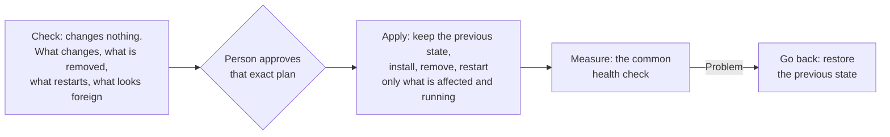

# Installing changes with one command and a map

The factory's programs live in a repository and run on a separate machine. Every change has to get
from one to the other.

## The problem

- **A new installer for every change.** Each change shipped with its own one-off script, which was
  run once and thrown away: 76 of them were retired in a single clean-up.
- **Nothing written said where each file goes.** The only record was scattered across those scripts.
- **Copies drifted.** The installers only carried what each change needed, so the test copies on the
  machine fell behind: 13 of 18 standalone test files were old versions.

Adding something to the factory meant writing an installer. The goal is the opposite: adding a file
should mean adding a line.

## How it works now

**The map** is a declared list with one line per file that goes to the machine: where it goes, who
owns it, its permissions, and what has to restart if it changes. A file that leaves the map is
removed at the next install, because the command remembers what it installed. Every file in the
repository needs a line, or a stated reason why it does not go to the machine; a test fails
otherwise.

**One permanent command** runs in four steps:

- **It does not touch anything while work is running.** The same gate will serve the command that
  updates the machine itself.
- **Foreign differences stop it.** Anything on the machine that is not what the command installed is
  shown, and the command stops until a person decides.
- **It applies only the approved plan.** Check prints a fingerprint of the plan, including the
  current content of every foreign file. Apply requires that fingerprint and refuses if anything
  differs from what the person read.
- **The machine records what it has.** The installed commit lives on the machine, not in a document.

**The health check** is one command instead of about forty-five test suites run one by one plus a
list of manual checks. It covers the installed files, the services, each conversational agent,
the seeded email-filter attempt on each agent, the integrity of the task record, and every test
suite that can run there. Each suite declares in its own header where it runs. Suites that cannot
run on that machine are listed with their reason on every run, not silently skipped.

## What was verified

On the factory's machine, run by the owner with approval at each step:

| Step | Result |
|---|---|
| First check | 20 foreign differences, all in the test copy: 16 old versions, 3 retired files and a Python cache. The survey written before the command had missed the cache; the command did not |
| Apply | 192 files added, 18 replaced, 28 removed; no service restarted |
| Health check | Green: services, both agents answering, the email filter blocking on both, record intact, 35 test suites passing |
| Go back, on the real machine | The next check reproduced, line by line, the state before installing |
| Install again and measure | Green |

Before the first install on the real machine, the same sequence was rehearsed against a copy of
what the survey found. Going back exposed a bug: an emptied folder came back with the wrong
permissions. The backup now records folders as well as files.

## A lesson from the review

The first version had a single "accept foreign differences" switch. A reviewer pointed out that it
accepted *any* difference, including one appearing between check and apply. Approving the
fingerprint of the exact plan closed that gap, and it also covers the list of files to be removed.

## Limits

- A person runs every step; making it automatic is a separate decision.
- Going back keeps only one step and restores programs, not migrated data.
- Twelve test suites do not run on that machine. Six need a container, a disposable machine or
  their own arguments, or test the computer-side command. Six need a tool that is missing there or
  not yet connected to the check. The health check lists them every time.
- The other half, a command that updates the machine itself, is designed but not built.
