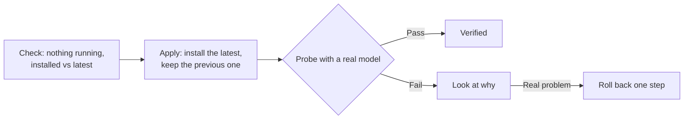

# Keeping the agent runtimes current

The agents run inside two third-party programs, called **runtimes**: one for Anthropic's models and
one for the rest. Both publish new versions almost every day.

## The problem

The factory had been built carefully, and the care had turned into friction:

- one runtime's installer only accepted the exact version written in a file, with its checksums,
  prepared by hand for each release;
- two plugins the factory loads into that runtime refused to start on any version but the one they
  were tested with;
- dozens of one-off scripts, with versions, checksums and dates baked in, were still lying around.

Updating was a project. And a version requirement does not tell you whether the new version works.
It only stops you from finding out.

## The rule

1. **No tool requires a specific version** of anything, or hard-codes a checksum of something an
   update changes.
2. **Check the effect, not the version.**
3. **Delete what is no longer used.** A one-off script goes as soon as its result is recorded.

## How an update works

A person runs one command per runtime, in four steps:

- **The publisher vouches for the package**: the package repository's signature for one runtime,
  and the integrity hash npm publishes for the other. Nobody copies a checksum by hand.
- **What must not change is compared before and after**, not against a value written in the script:
  the security policy, the role scripts, the terminal and the plugins.
- **The probe checks what the agents depend on**, for a few cents:
  - the implementer has the factory's [terminal](agent-terminal.md) from its first request, and uses it;
  - it can write to its workspace;
  - in a fresh box, without the credential, it resumes the same conversation, as it does in each
    round of the checks;
  - the reviewer runs in its own session;
  - the output contains nothing shaped like a credential.

**Why removing the plugins' version check is safe.** The plugin that waits for the terminal leaves
marks in the log, and the factory already rejects any run without them. If a new runtime version
breaks it, the failure shows; it is never silent. The other plugin only measures: if it breaks, that
measurement becomes "unknown" and the work goes on.

Nothing updates itself. Automating it would be a separate decision, once the manual flow has proven
reliable.

## What happened the first time

- **The first runtime moved up several patch versions**; the probe passed first time.
- **The second jumped a minor version, and the probe failed**: a possible credential in all three
  calls. It was a false alarm. The new version's built-in instructions to agents say *"Do not infer
  authorization…"*, and the plugin that records what agents receive logged that text. The pattern
  matched the bare word. It now matches only credential shapes, and a test pins what must and must
  not match, that sentence included. The re-run passed.
- **A local test of the new installer caught another bug before it reached the machine**: the server
  that announces the latest version rejected the scripting language's HTTP client and accepted `curl`.

A version requirement would have blocked the second update without saying whether it worked. The
effect check let it through, raised an alarm worth reading, and then verified it.

## Limits

- The probe is not a full task. It checks the pieces the agents depend on, not the quality of their
  work.
- Rolling back changes the program, not its data. If the new version migrated its data, the old one
  might not read it.
- Only one step back is kept.
- The credential pattern is a safety net, not a guarantee: it looks for known shapes.
