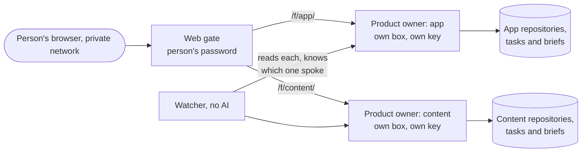

# A product owner per workstream

## The problem

The **product owner** is the agent you talk to before any work starts. It reads the project, asks
questions, offers alternatives and, when an idea is ready, proposes a task. Programs without AI do
the bookkeeping around it: they record what it delivers and apply what the person approves.

Three things did not hold up:

- **Conversations end, decisions should not.** What was agreed lived only in a chat. A new session
  started without it, and an endless chat is expensive and drifts.
- **One agent saw everything.** A single product owner served every workstream, read every
  repository and every task, and **the model's own text said which workstream** a delivery belonged
  to. Workstreams can be unrelated — a product, a job search, an investing experiment — so one should
  never see or propose anything about another.
- **The model was fixed.** The conversation server only offered some providers' models, and its
  configuration pinned one of them.

## How it works now

### Briefs the person approves

The product owner writes a **brief** for each topic: goal, decisions with their reasons and what was
ruled out, proposals, open questions, sources and next step. A program registers it as pending and
shows the person exactly what would be saved, ending with the exact text to type to approve it.

- It is saved only when the person approves **that revision, in that conversation**. Text written
  by the model or by a system notice does not count, and a new revision invalidates the previous one.
- Saved briefs are kept as numbered revisions, with the title in the name, and any later session can
  read them.

**Lesson:** the first version required every decision to quote the person's literal words. That was
not sound: saying "yes" to a proposal is also deciding. Approving what gets saved solved both
problems at once, and the person reads the text before it counts.

### One product owner per workstream

- **The workstream is fixed by the server, not by the model.** The watcher visits each product owner
  in turn and knows which one a delivery came from. A delivery naming another workstream is rejected,
  and the agent is told which one it belongs to.
- **Each one only reaches its own.** Its box holds its workstream's repositories, tasks and briefs,
  with indexes that never name anything else. There is no copy of the rest to read.
- **Nothing crosses over.** A draft task can only be revised from its own product owner, a brief
  cannot change workstream, and an approval only counts in the conversation that showed it.
- **A key per product owner.** Each server requires its own; no box holds another's.
- **One down does not stop the others.** The watcher notes it and carries on.
- **They started from scratch.** Old conversations were not carried over: what mattered already
  lived in the saved briefs and tasks.

### One address, a path per workstream

All product owners are reached at the same address and port. The web gate serves the page at the
root, with no access to any agent there, and each workstream's path leads to its product owner: it
strips the prefix and replaces the person's password with that agent's key. Adding a workstream
changes only the gate, not the network.

Measured first with two isolated servers: the chat client's web page **does not work served under a
path** — it asks for its files and API at the root. But it accepts **several servers added by hand**,
and through each server's path went the project list, the event stream, the conversation and the
terminal. A conversation created through one path existed only on that server. Two more findings
while implementing: the page itself needs no agent key, so the root carries none; and the path after
the prefix is forwarded exactly as the browser sent it, so a route that walks into another
workstream with `..`, or hides it behind encoded slashes, is refused.

### Claude as one more model

The conversation server gained a provider that launches the installed Claude program with its own
login. Claude is now chosen from the same list as every other model, and no model is pinned in the
configuration.

- **A login per product owner**, inside its box and separate from the coding agents', so renewing
  one never overwrites another.
- **The tools stay the server's.** Measured: with Claude, the product owner reads, searches and asks
  permission to go to the web, but has no terminal and cannot write. The configuration rule that
  denies everything not allowed is essential: without it, the same model created a file through the
  terminal.
- **The account email does not leave through the web**: a separate
  [filter](account-email-filter.md) covers it.
- **Accepted risk:** the provider is not offered by the model's maker, which has blocked
  subscription use from third-party tools before. If it does again, the product owners keep the
  other models, and briefs and tasks do not change.

## What it separates, and what it does not

Separating the product owners stops **a model** from reading or proposing across workstreams. It does
not try to separate the person, who works in all of them.

- They share the model subscriptions, like every other agent in the factory.
- They share one browser origin, because they share one address. A flaw in the web page that ran
  model-written content could reach another product owner with the person's session. That is the
  price of not adding ports or names; the page that starts tasks lives on a different origin.
- They share one record: task and brief numbers stay unique, and what is split is what each agent
  can read.

## Evidence

- **Briefs, tested by the person** (November 2026): a test brief was approved with the exact text,
  and a new session recovered its goal, decisions and next step from the saved brief alone, without
  the earlier chat. One test brief, not a real topic: it does not measure the quality of the
  summaries.
- **Workstream split, tested without models:** two fake servers with different keys covered
  deliveries naming another workstream, cross-workstream drafts and approvals, a server that is down,
  a conversation that fails to load, and each box's contents. The real web server in a Linux
  container covered the root without access, each path reaching only its server with its key, raw
  paths, `..` and encoded slashes refused, and the terminal's connection headers. Deliberately broken
  copies of the code were each caught by a test, after fixing a harness that had made every copy look
  caught.
- **Found while implementing:** failing to read a single conversation stopped the watcher's whole
  round, so with several product owners one bad session would have stalled all of them. Now it is
  noted and the round continues.
- **Verified on the factory's machine** (November 2026): two product owners running, each with its own
  key, box and path; from a computer's browser over the private network, each one, running on Claude, saw
  only its workstream's repositories; after a restart of the machine, everything came back on its own.

## What remains open

- The phone is not tested yet, by the owner's decision.
- The per-path web depends on a feature of the chat client's page; it is rechecked after each update.
- Briefs are approved by typing a text; a button may replace it later.
