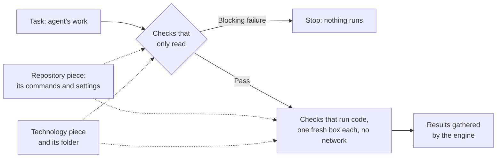

# Checking a technology: three levels, and an engine that names none

The factory checks an agent's work with automatic checks before any review. Those checks depend on
the technology: a Flutter app is analyzed, formatted, tested and built differently from a website.
This page covers how a technology plugs into the factory, and the first one moved to that shape.

## The problem

- **The engine knew one technology by heart.** Every check for Flutter apps was written inside the
  factory's own programs: their names, their order, the files an agent must not touch, the text
  that tells the agent how to run them. Adding a second technology meant editing the engine.
- **One product had leaked into the technology.** Some of those "Flutter" checks were really about
  one app: a rule from that app's own linter, used to prove the linter is running; the one marker
  that app allows; building for the web; two empty items that app needs to compile. Another Flutter
  app would have failed the analysis every time.
- **Squeezing every check into a few declarable types was considered and rejected.** It would make
  adding a technology easy at the cost of the finer checks. Quality of what is checked comes first.

## How it works now

**Three levels, and each technology climbs only as far as it needs:**

| Level | What it is | How it connects |
|---|---|---|
| 1. Basic | The project's own commands: analyze, test, build | The repository declares them in its piece |
| 2. Declared | What a common technology shares: files an agent must not touch, what it generates | A technology piece: one small file |
| 3. Own program | The finer checks of a technology | Its piece plus a small folder of code, with a fixed contract |

- **The engine runs the levels and gathers the results; it names no technology.** What is specific
  lives in the technology's piece and folder, and what is specific to one product lives in that
  product's repository piece. Flutter now serves any app.
- **Two kinds of checks, kept apart on purpose.** Checks that only read files (for example, "did
  the agent add a trick to silence the linter?") run first, in the factory itself, and can stop the
  rest from running. Checks that run the agent's code (tests, build) run as a separate user, each
  command in a fresh box with no network, so the code being checked cannot reach the result.
- **What a box may run comes from the pieces, not from the task.** The tools a check may start
  with, the file types that count, and every setting that ends up inside a command are read from
  the installed pieces and validated strictly. A technology's code is loaded only from what a person
  installed.

## What was verified

| Check | Result |
|---|---|
| Same behavior | Before moving anything, everything a real Flutter task sees was recorded with the old code: brief texts, expected checks, read-only checks and what the checker returns when it really runs. After the change it comes out identical, byte for byte |
| Connecting | In tests, a new technology connects at each level with only its piece, or its piece and its folder, without touching the engine. Seventeen kinds of malformed technology pieces or settings are rejected |
| On the factory's machine | Installed by the owner with approval, with a new single install command. Health check green: both conversational agents answering, the task record intact and 38 test suites passing, including the two new ones |

## Lessons

- **Record "before" before you move.** The byte-for-byte comparison was written and passed against
  the old code first, so the expected values were measured, not typed by hand.
- **A reviewer found what tests had not.** A second agent reviewed the change before installing it
  and found that the install would have stopped: it reads the pieces already on the machine with the
  new reader, and those older pieces had no technology piece yet. It was fixed and tested before
  installing.
- **The owner asked for less ceremony.** Installing took three commands and copying a fingerprint.
  It is now one command with one password: it checks, shows the plan, asks, applies that same plan
  and runs the health check.

## Limits

- Only the checking side is generic. Preparing the agent's box (copying the toolchain and the
  project's installed packages) is still Flutter-only, with a pinned version. That changes when the
  toolchain becomes updatable, the next step.
- Web technologies come after that: the machine has no web runtime yet.
- Checks must still be compared with the starting point today: old analysis findings do not block a
  task. The owner decided that every check must pass in full, with the task fixing old failures and
  the pull request listing what failed. That is designed, not built.
